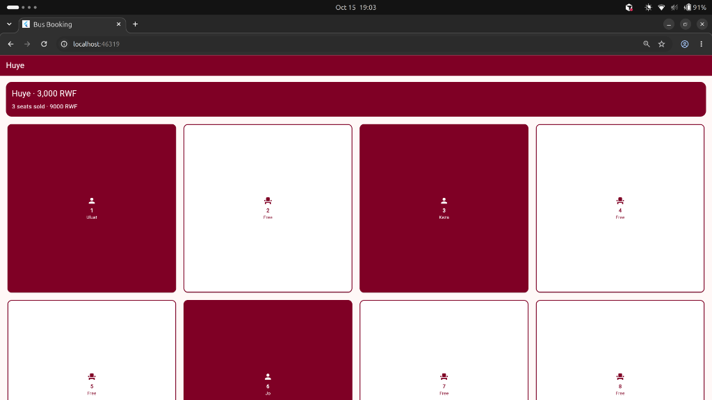

# Bus Booking

A Huye bus seat map. The fare is 3,000 RWF, and the bus has 12 seats. Each person signs in and only sees their own bookings.

Mukunzi Jonathan · 27132

Project: Bus Booking

## What it does

You create an account or log in with email and password. A new account starts with three sample bookings: seat 1 Uluat, seat 3 Keza, and seat 6 Jo.

The seat map shows free and taken seats differently. The header shows how many seats are sold and how much money that is. Those totals are worked out from the bookings. They are not stored.

Tap a free seat to book it. The passenger name cannot be empty or already used. The cash handed over must be at least 3,000 RWF and a multiple of 100. The change is paid in the biggest notes first: 5,000, 2,000, 1,000, 500, and 100.

Tap a taken seat to see the passenger, the cash, and the change. Cancel asks you to confirm, then deletes that booking. If someone is on the waitlist, the first person moves into the seat. Priority passengers (elderly, pregnant, or disabled) stay ahead of everyone else.

The waitlist opens from the groups icon. You can join only when all 12 seats are taken.

Log out from the seat map. A second account has its own seats and its own waitlist. Bookings are saved in Cloud Firestore under `users/{id}/bookings`, and the waitlist under `users/{id}/waitlist`. A change in Firestore shows up in the app on its own.

## Run it

Open the project in Android Studio and run it on a device or emulator. `google-services.json` belongs in `android/app/` on your machine. It is not in this repository.

## Screenshots

